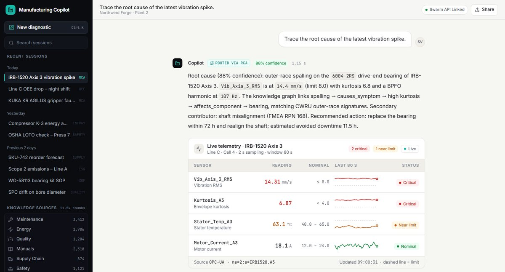
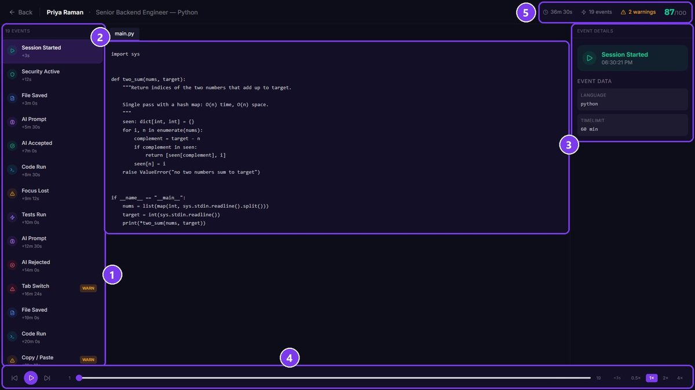
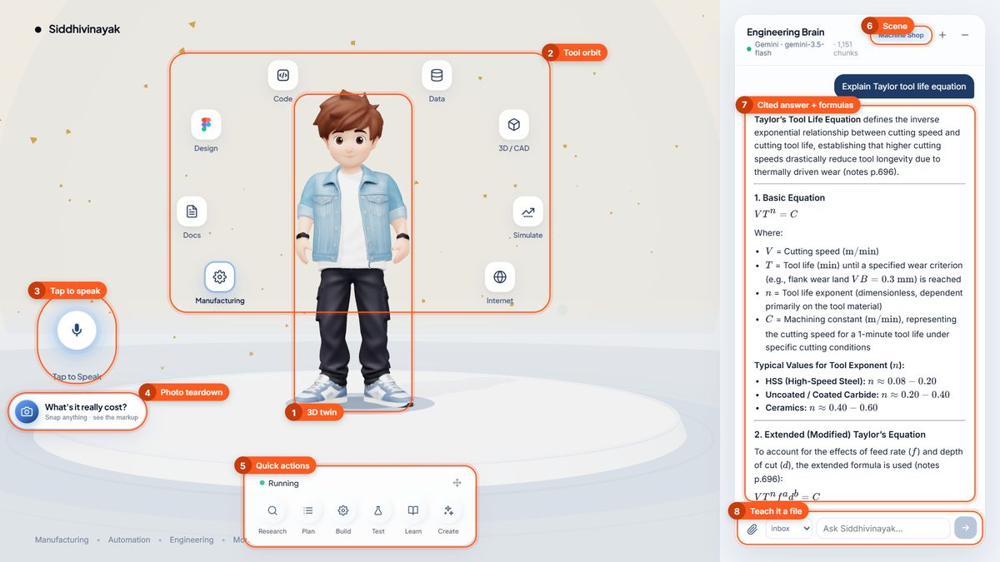
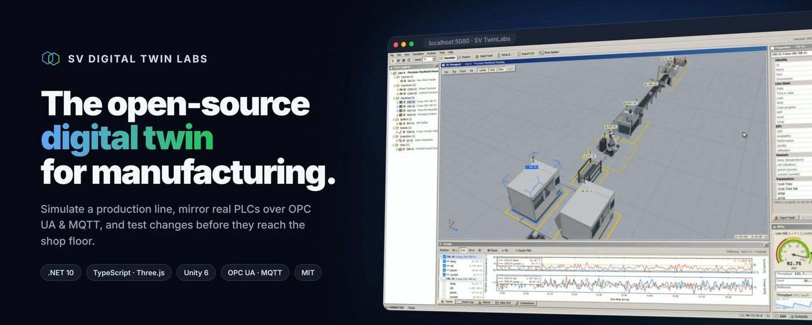
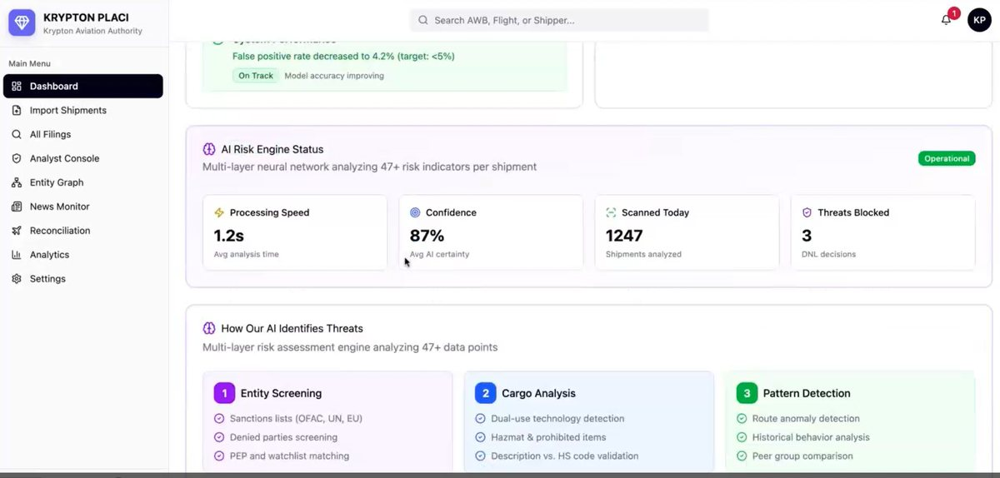
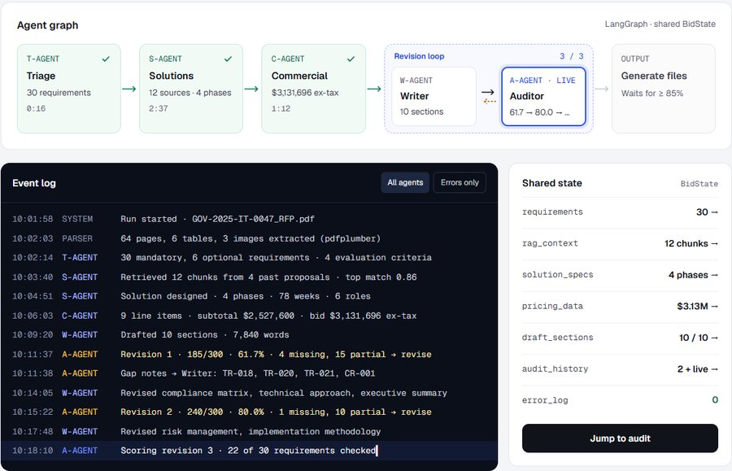
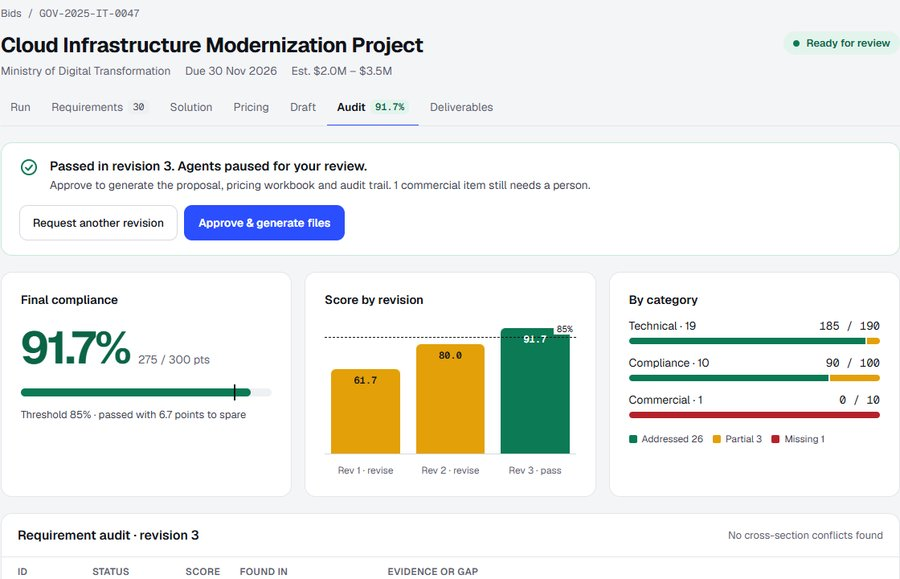
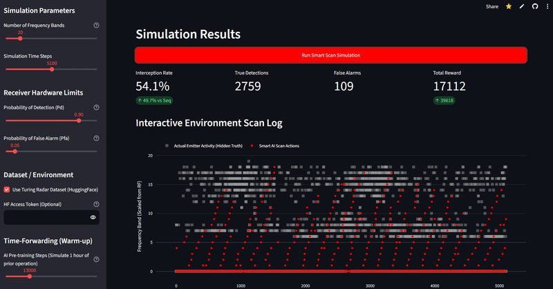

# Hey, I'm Siddhivinayak 👋

**I build AI for factories, and for the paperwork around them.**

Manufacturing engineer by degree (BTech, Manufacturing Science & Technology, COEP Technological University, Pune). Builder by habit. I like agents, retrieval, digital twins, and anything that turns a 600-page PDF into a straight answer.

🚀 **Open to:** building with early-stage startups as a founding engineer or co-founder (industrial AI, B2B automation), and AI/ML engineering roles (agentic systems, RAG, applied ML).

---

## How I got here

I started on the shop floor, learning about tool wear, OEE and how production lines behave, and that machines tend to break down shortly before a shift ends. Then I noticed that most of a factory's problems are buried in documents: tenders, compliance rules, cargo regulations and manuals. Everyone agrees they matter, and nobody wants to read them.

So I build AI that reads them for you. Here's what has come out of that so far.

---

## Things I've built

### 1 · Self-Maintaining APIs · *private repo, demo on request*
*Vendors retire API versions, and this agent makes sure your integration doesn't break with them.*

An agent that stops third-party API integrations from breaking when vendors retire versions.
- Monitors vendor deprecation notices and scans the codebase for affected calls
- Prepares a fix for each call and runs the tests in an offline Docker sandbox before and after the patch
- Opens a pull request for human approval and never merges on its own

Demo targets: [support-desk-ai](https://github.com/siddhivinayak-ai/support-desk-ai) · [stripe-legacy-checkout](https://github.com/siddhivinayak-ai/stripe-legacy-checkout)

### 2 · [Manufacturing Copilot](https://github.com/siddhivinayak-ai/mfg-copilotv0.1)
*For when a machine is vibrating, the manual is 600 pages long and the shift ends in 20 minutes.*

Asked why a robot axis is vibrating, it points to a worn bearing and shows the sensor readings behind the answer.

A reasoning engine for factories. It answers maintenance, quality, energy, safety and supply-chain questions using sensor datasets, OEM manuals and regulations.
- GraphRAG over a 7-domain knowledge graph (~10,000 nodes, ~21,000 edges) built from NASA C-MAPSS, CWRU bearings, SECOM and others, plus ABB, KUKA, Siemens and UR robot manuals
- An orchestrator sends each question to one of 6 specialist agents
- Connects facts across domains: a vibration spike → the related OSHA hazard → the matching KUKA error code

`Python` `GraphRAG` `Multi-agent orchestration`

### 3 · [hiresprint: Agentic Hiring Intelligence](https://github.com/siddhivinayak-ai/hiresprint)
*Using AI in an interview isn't cheating anymore. Using it badly is.*

Session replay. And yes, it noticed that tab switch.

Tests whether engineers can build *with* AI, not just code without it.
- Candidates solve a realistic task in a sandboxed IDE that includes an AI assistant, a terminal and a test runner
- Scores five weighted dimensions, including prompt quality and error recovery
- Records a full session replay, plus integrity signals: tab switches, focus loss and pastes

`React` `Node.js` `PostgreSQL` `LangChain` `Gemini`

### 4 · [Siddhivinayak: the 3D engineer](https://github.com/siddhivinayak-ai/siddhivinayak)
*Yes, I named it after myself. It knows more torque values than I do.*

It cites the page number, so I can't argue with it.

A talking 3D engineering assistant, backed by a brain that learns from your notes.
- Hybrid search (dense vectors plus BM25) over your own PDFs, with page citations that open the original page
- Python does the maths, not the LLM: ISO thread geometry, VDI 2230 tightening torque, AWS electrode decoding, weld heat input
- Photo teardown: snap any object and it estimates what it really costs to make, then shows the markup

`React Three Fiber` `Python` `LangGraph` `RAG`

### 5 · [SV Digital Twin Labs](https://github.com/siddhivinayak-ai/SV-DigitalTwinLabs) · *in active development*
*Break the factory in simulation so nobody has to break it on Monday morning.*

An open-source digital twin of a manufacturing production line.
- A C# simulation server streams live machine state over WebSocket to a web console and a Unity 3D client
- V1 covers one line: 11 assets, synthetic sensors, fault injection, OEE analytics and what-if scenarios
- One shared wire contract defines the data format for the server and every client

`C#` `.NET 10` `TypeScript` `Three.js` `Unity 6`

### 6 · [PLACI: Cargo Risk Intelligence](https://github.com/siddhivinayak-ai/placi-version-0.2)
*It reads the cargo paperwork before the cargo gets on the plane.*

  
  
   
  Left: the dashboard. Right: <b>building days.</b> That's me on the left, laughing. The demo was working. For the moment.

Screens air cargo before loading, following ICAO Annex 17, the WCO SAFE Framework and PLACI (Pre-Loading Advance Cargo Information) rules.
- 6 agents in a LangGraph workflow: sanctions matching, cargo-description analysis, anomaly detection (Isolation Forest), historical pattern search, risk aggregation, and an explanation a regulator can read
- Each shipment gets a risk score and a decision (clear, request information, extra screening, or do not load), with the evidence behind it
- Tested against 10,000 synthetic historical shipments

`Python` `FastAPI` `LangGraph` `Claude` `MongoDB` `React`

### 7 · [BidOps: from RFP to proposal](https://github.com/siddhivinayak-ai/BidOpsv0.1)
*Five agents work on every bid, and one of them is very hard to please.*

  
  
   
  Left: the agents at work, with the writer and auditor stuck in a revision loop. Right: told you it was hard to please. Three revisions before the auditor let it through.

Turns a tender PDF into a technical proposal (.docx) and a pricing model (.xlsx).
- Five agents: triage, solution design, commercial pricing, writer and auditor
- The auditor sends drafts back to the writer until the proposal reaches an 85% compliance score against the RFP's requirements
- Searches past proposals using local embeddings, so company data stays on the machine

`Python` `LangGraph` `ChromaDB` `Gemini`

### 8 · [SmartScan: RF scanning for electronic warfare](https://github.com/siddhivinayak-ai/sih-DevNexus2026) · *Smart India Hackathon 2026*
*A radio receiver can only listen to one band at a time. So which band should it check next?*

Grey: where the emitters actually were. Red: where the agent looked.

Built for SIH 2026 problem statement 26055: a smart scan strategy for electronic warfare when there is no reliable prior intelligence about the emitters.
- A reinforcement-learning (PPO) scheduler decides which RF band the receiver scans next, based only on what it has observed so far
- A Gymnasium RF environment with hidden ground truth and a limited-bandwidth receiver, plus optional emitter data from the Alan Turing Institute's Turing Synthetic Radar Dataset
- Evaluated against three baselines (open-loop sweep, random and a POMDP heuristic) on unseen test scenarios

`Python` `Gymnasium` `Stable-Baselines3` `PyTorch` `Streamlit`

---

## Side quests

- **[BhashaBill](https://github.com/siddhivinayak-ai/BhashaBill)**: turns voice notes and bills in Hindi, Tamil or Gujarati into standard government Bills of Materials, for small businesses (MSMEs) bidding on tenders.
- **[mill](https://github.com/siddhivinayak-ai/mill)**: tool-wear prediction on the UC Berkeley milling dataset. An LSTM beat Random Forest and XGBoost.
- **[code-writer](https://github.com/siddhivinayak-ai/code-writer-v0.1)**: a terminal coding agent built to run within Gemini's free-tier limits.
- **[sv-iot-telemetry-sim](https://github.com/siddhivinayak-ai/sv-iot-telemetry-sim)**: a pip package that simulates industrial sensors, with anomaly injection and MQTT streaming.

---

## My toolbox

| | |
|---|---|
| **AI / ML** | LangGraph, LangChain, RAG and GraphRAG, ChromaDB, FAISS, scikit-learn, TensorFlow, PyTorch, Stable-Baselines3 |
| **LLMs** | Claude, Gemini, Groq, local models via Ollama |
| **Backend** | Python, FastAPI, Flask, Node.js, C# / .NET, MongoDB, PostgreSQL, SQLite, WebSockets, MQTT |
| **Frontend & 3D** | React, TypeScript, Vite, Three.js / React Three Fiber, Unity, Streamlit |

## How I build

- **Problem first.** I start from the domain problem, then choose the model.
- **Ship v0.1, then iterate.** PLACI went through three versions in public. You can tell from the repo names: most of them end in a version number.
- **Local and low-cost by default.** Local embeddings, swappable LLM providers, and designs that fit within free-tier limits. Free tiers have taught me more about rate limits than any course.

## Let's build something

Building a startup in industrial AI, B2B automation or anything with too much paperwork? I'd love to hear about it. I'm happy to talk ideas, build a v0.1 with you, or join as a founding engineer.

[LinkedIn](https://www.linkedin.com/in/siddhivinayak-waghmode-641b6b241/) · [Email](mailto:siddhivinayakwaghmode2004@gmail.com)

Pune, India
