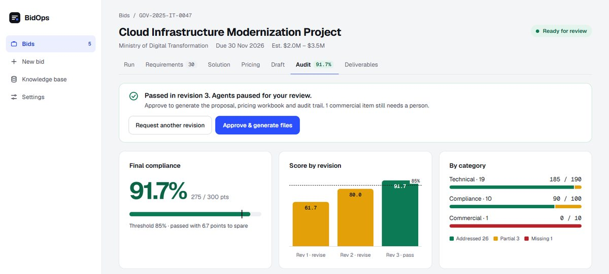
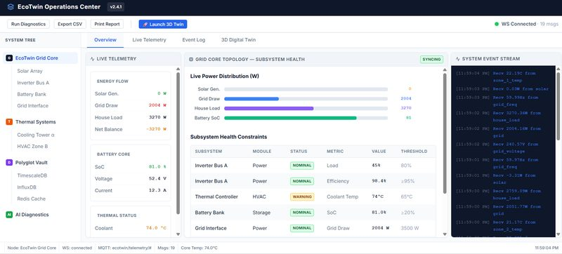

# Siddhivinayak Waghmode

**I build AI systems for manufacturing and industrial operations.**

**Open to:** co-founding in industrial AI or B2B automation, and AI/ML engineering roles (agentic systems, RAG, applied ML).

---

## The story so far

**Chapter 1: The shop floor.**
I trained as a manufacturing engineer (BTech, Manufacturing Science & Technology, COEP Technological University, Pune). I learned about tool wear, OEE and how production lines behave, and that machines tend to break down shortly before a shift ends.

**Chapter 2: The paperwork.**
Then I noticed that most of a factory's problems are buried in documents: tenders, compliance rules, cargo regulations, procurement files and 600-page manuals. Everyone agrees these documents matter, and nobody wants to read them.

**Chapter 3: The agents.**
So now I build AI that reads them: agentic systems, retrieval and digital twins that understand the shop floor *and* the paperwork around it. The episodes below are what came out of that.

---

## Selected work

### Episode 1 · [Manufacturing Copilot](https://github.com/siddhivinayak-ai/mfg-copilotv0.1)
*For when a machine is vibrating, the manual is 600 pages long and the shift ends in 20 minutes.*

Asked why a robot axis is vibrating, it points to a worn bearing and shows the sensor readings behind the answer.

A reasoning engine for factories. It answers maintenance, quality, energy, safety and supply-chain questions using sensor datasets, OEM manuals and regulations.
- GraphRAG over a 7-domain knowledge graph (~10,000 nodes, ~21,000 edges) built from NASA C-MAPSS, CWRU bearings, SECOM and others, plus ABB, KUKA, Siemens and UR robot manuals
- An orchestrator sends each question to one of 6 specialist agents
- Connects facts across domains: a vibration spike → the related OSHA hazard → the matching KUKA error code

`Python` `GraphRAG` `Multi-agent orchestration`

### Episode 2 · [SV Digital Twin Labs](https://github.com/siddhivinayak-ai/SV-DigitalTwinLabs) · *in active development*
*Break the factory in simulation so nobody has to break it on Monday morning.*

An open-source digital twin of a manufacturing production line.
- A C# simulation server streams live machine state over WebSocket to a web console and a Unity 3D client
- V1 covers one line: 11 assets, synthetic sensors, fault injection, OEE analytics and what-if scenarios
- One shared wire contract defines the data format for the server and every client

`C#` `.NET 10` `TypeScript` `Three.js` `Unity 6`

### Episode 3 · [PLACI: Cargo Risk Intelligence](https://github.com/siddhivinayak-ai/placi-version-0.2)
*It reads the cargo paperwork before the cargo gets on the plane.*

Screens air cargo before loading, following ICAO Annex 17, the WCO SAFE Framework and PLACI (Pre-Loading Advance Cargo Information) rules.
- 6 agents in a LangGraph workflow: sanctions matching, cargo-description analysis, anomaly detection (Isolation Forest), historical pattern search, risk aggregation, and an explanation a regulator can read
- Each shipment gets a risk score and a decision (clear, request information, extra screening, or do not load), with the evidence behind it
- Tested against 10,000 synthetic historical shipments

`Python` `FastAPI` `LangGraph` `Claude` `MongoDB` `React`

### Episode 4 · [BidOps: from RFP to proposal](https://github.com/siddhivinayak-ai/BidOpsv0.1)
*Five agents work on every bid, and one of them is very hard to please.*

Turns a tender PDF into a technical proposal (.docx) and a pricing model (.xlsx).
- Five agents: triage, solution design, commercial pricing, writer and auditor
- The auditor sends drafts back to the writer until the proposal reaches an 85% compliance score against the RFP's requirements
- Searches past proposals using local embeddings, so company data stays on the machine

`Python` `LangGraph` `ChromaDB` `Gemini`

### Episode 5 · [hiresprint: Agentic Hiring Intelligence](https://github.com/siddhivinayak-ai/hiresprint)
*Using AI in an interview isn't cheating anymore. Using it badly is.*

Session replay. And yes, it noticed that tab switch.

Tests whether engineers can build *with* AI, not just code without it.
- Candidates solve a realistic task in a sandboxed IDE that includes an AI assistant, a terminal and a test runner
- Scores five weighted dimensions, including prompt quality and error recovery
- Records a full session replay, plus integrity signals: tab switches, focus loss and pastes

`React` `Node.js` `PostgreSQL` `LangChain` `Gemini`

### Episode 6 · Self-Maintaining APIs · *private repo, demo on request*
*Vendors retire API versions, and this agent makes sure your integration doesn't break with them.*

An agent that stops third-party API integrations from breaking when vendors retire versions.
- Monitors vendor deprecation notices and scans the codebase for affected calls
- Prepares a fix for each call and runs the tests in an offline Docker sandbox before and after the patch
- Opens a pull request for human approval and never merges on its own

Demo targets: [support-desk-ai](https://github.com/siddhivinayak-ai/support-desk-ai) · [stripe-legacy-checkout](https://github.com/siddhivinayak-ai/stripe-legacy-checkout)

---

## Side quests

<table>
<tr>
<td width="33%" valign="top">

<b><a href="https://github.com/siddhivinayak-ai/siddhivinayak">Siddhivinayak</a></b> 
A talking 3D engineering assistant. Hybrid search over your notes with page citations, plus ISO fastener and welding calculators. It cites the page, so I can't argue with it.
</td>
<td width="33%" valign="top">

<b><a href="https://github.com/siddhivinayak-ai/sih-DevNexus2026">SmartScan</a></b> · Smart India Hackathon 2026 
A reinforcement-learning (PPO) scheduler that decides which RF band a receiver scans next. Evaluated against three baselines on unseen test scenarios.
</td>
<td width="33%" valign="top">

<b><a href="https://github.com/siddhivinayak-ai/EcoTwin">EcoTwin</a></b> 
An energy digital twin (solar, battery, grid, HVAC) with a live 3D view.
</td>
</tr>
</table>

- **[BhashaBill](https://github.com/siddhivinayak-ai/BhashaBill)**: turns voice notes and bills in Hindi, Tamil or Gujarati into standard government Bills of Materials, for small businesses (MSMEs) bidding on tenders.
- **[mill](https://github.com/siddhivinayak-ai/mill)**: tool-wear prediction on the UC Berkeley milling dataset. An LSTM beat Random Forest and XGBoost.
- **[code-writer](https://github.com/siddhivinayak-ai/code-writer-v0.1)**: a terminal coding agent built to run within Gemini's free-tier limits.
- **[sv-iot-telemetry-sim](https://github.com/siddhivinayak-ai/sv-iot-telemetry-sim)**: a pip package that simulates industrial sensors, with anomaly injection and MQTT streaming.

---

## Stack

| | |
|---|---|
| **AI / ML** | LangGraph, LangChain, RAG and GraphRAG, ChromaDB, FAISS, scikit-learn, TensorFlow, PyTorch, Stable-Baselines3 |
| **LLMs** | Claude, Gemini, Groq, local models via Ollama |
| **Backend** | Python, FastAPI, Flask, Node.js, C# / .NET, MongoDB, PostgreSQL, SQLite, WebSockets, MQTT |
| **Frontend & 3D** | React, TypeScript, Vite, Three.js / React Three Fiber, Unity, Streamlit |

## How I work

- **Problem first.** I start from the domain problem, then choose the model.
- **Ship v0.1, then iterate.** PLACI went through three versions in public. You can tell from the repo names: most of them end in a version number.
- **Local and low-cost by default.** Local embeddings, swappable LLM providers, and designs that fit within free-tier limits. Free tiers have taught me more about rate limits than any course.

## Next chapter

Still being written. If you're building something for factories, supply chains or the paperwork between them, I'd like to hear about it. [LinkedIn](https://www.linkedin.com/in/siddhivinayak-waghmode-641b6b241/) or [email](mailto:siddhivinayakwaghmode2004@gmail.com) works.

Pune, India
